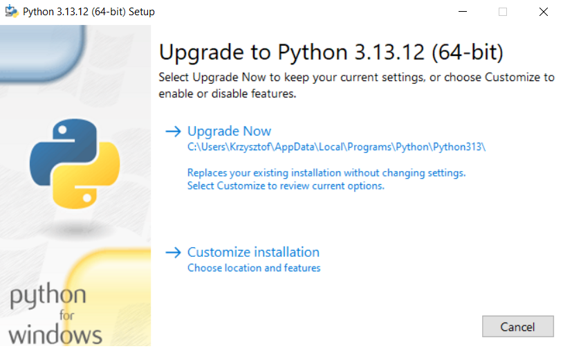
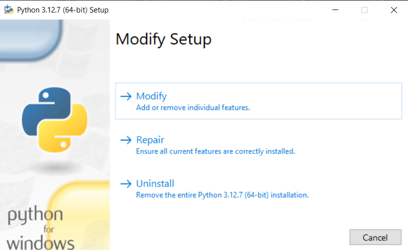
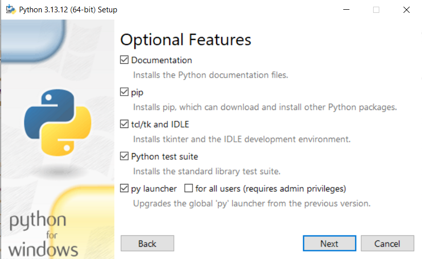
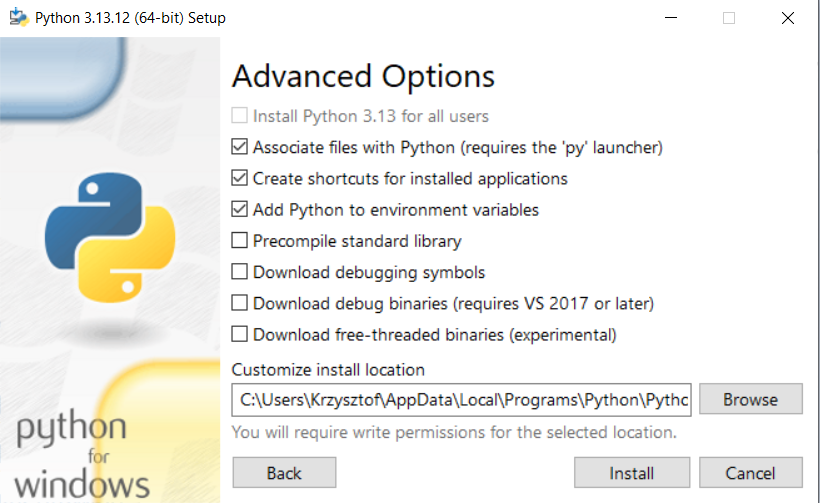
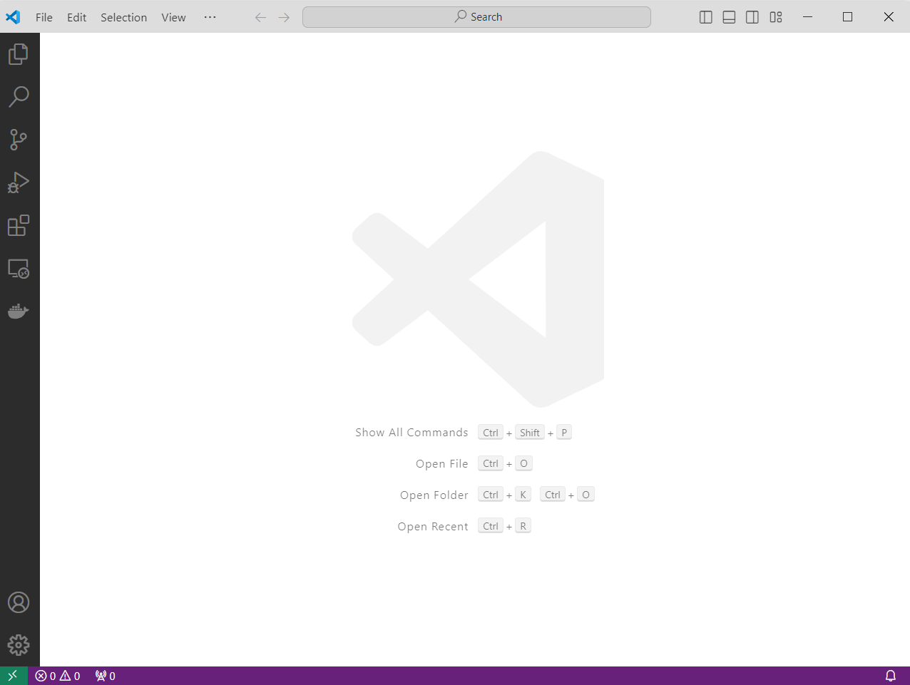
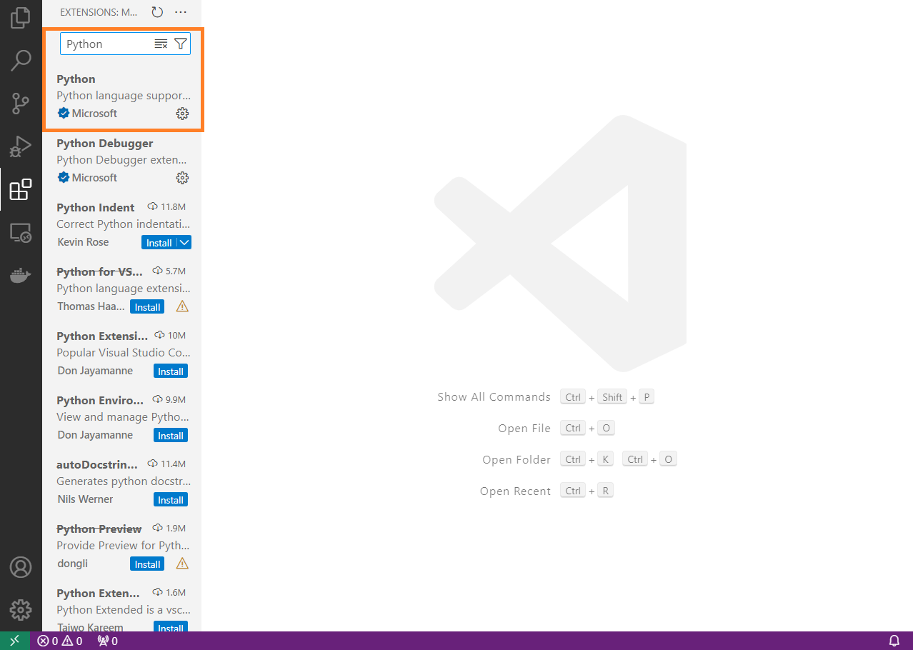

# Moduł 0: Przygotowanie środowiska pracy, zarządzanie pakietami i uruchamianie kodu

> **Oficjalna dokumentacja referencyjna:**
> - Dokumentacja Python 3.14 — instalacja i użycie: [https://docs.python.org/3.14/using/index.html](https://docs.python.org/3.14/using/index.html)
> - Specyfika systemu Windows (w tym `py` launcher): [https://docs.python.org/3.14/using/windows.html](https://docs.python.org/3.14/using/windows.html)
> - Środowiska wirtualne (`venv`): [https://docs.python.org/3.14/library/venv.html](https://docs.python.org/3.14/library/venv.html)
> - Menedżer pakietów `pip`: [https://pip.pypa.io/en/stable/](https://pip.pypa.io/en/stable/)
> - Specyfikatory wersji pakietów (**PEP 440**): [https://peps.python.org/pep-0440/#version-specifiers](https://peps.python.org/pep-0440/#version-specifiers)
> - Metadane projektu w `pyproject.toml` (**PEP 621**): [https://peps.python.org/pep-0621/](https://peps.python.org/pep-0621/)
> - Dokumentacja narzędzia `uv`: [https://docs.astral.sh/uv/](https://docs.astral.sh/uv/)
> - VS Code + Python Tutorial: [https://code.visualstudio.com/docs/python/python-tutorial](https://code.visualstudio.com/docs/python/python-tutorial)

---

## 1. Niezbędne oprogramowanie: IDE oraz interpreter języka Python

### 1.1. Zintegrowane środowisko programistyczne (IDE) — Wprowadzenie

Kod źródłowy w języku Python jest zwykłym tekstem zapisanym najczęściej w plikach z rozszerzeniem `.py` (skrypty i moduły) lub `.ipynb` (interaktywne notatniki Jupyter). Teoretycznie można go pisać w najprostszym Notatniku systemowym, jednak w codziennej pracy analityka danych i programisty korzystamy ze **zintegrowanych środowisk programistycznych (IDE — *Integrated Development Environment*)** lub zaawansowanych edytorów kodu. Podnoszą one produktywność dzięki:
- podświetlaniu składni i natychmiastowemu wykrywaniu błędów składniowych (*linting*),
- inteligentnemu podpowiadaniu nazw funkcji, metod i parametrów (*IntelliSense* / *autocompletion*),
- wbudowanemu debuggerowi pozwalającemu zatrzymywać program w wybranej linii i podglądać wartości zmiennych,
- integracji z terminalem, środowiskami wirtualnymi, systemem Git oraz notatnikami Jupyter.

Dwa najpopularniejsze obecnie narzędzia do pracy z językiem Python to:

1. **Visual Studio Code (VS Code)** firmy Microsoft ([https://code.visualstudio.com/](https://code.visualstudio.com/)) — lekkie, w pełni darmowe, wieloplatformowe (Windows, macOS, Linux) narzędzie, które rozbudowujemy za pomocą wtyczek (*Extensions*). Na naszych zajęciach jest to podstawowe środowisko pracy (wraz z rozszerzeniami **Python** oraz **Jupyter**).
2. **PyCharm IDE** firmy JetBrains ([https://www.jetbrains.com/pycharm/](https://www.jetbrains.com/pycharm/)) — rozbudowane środowisko dedykowane wyłącznie językowi Python, dostępne w dwóch wariantach:
   - **PyCharm Community Edition** — wersja w pełni darmowa (open-source), doskonała do pisania skryptów i modułów `.py`,
   - **PyCharm Professional** — wersja płatna, dostępna również bezpłatnie w ramach odnawianej co rok licencji akademickiej (z adresem e-mail w domenie uczelnianej). Porównanie obu edycji: [https://www.jetbrains.com/products/compare/?product=pycharm-ce&product=pycharm](https://www.jetbrains.com/products/compare/?product=pycharm-ce&product=pycharm).

**Warto mieć pod ręką (oficjalne zestawienia skrótów klawiszowych):**
- VS Code (Windows): [https://code.visualstudio.com/shortcuts/keyboard-shortcuts-windows.pdf](https://code.visualstudio.com/shortcuts/keyboard-shortcuts-windows.pdf)
- VS Code (macOS): [https://code.visualstudio.com/shortcuts/keyboard-shortcuts-macos.pdf](https://code.visualstudio.com/shortcuts/keyboard-shortcuts-macos.pdf)
- VS Code (Linux): [https://code.visualstudio.com/shortcuts/keyboard-shortcuts-linux.pdf](https://code.visualstudio.com/shortcuts/keyboard-shortcuts-linux.pdf)
- PyCharm Reference Card: [https://resources.jetbrains.com/storage/products/pycharm/docs/PyCharm_ReferenceCard.pdf](https://resources.jetbrains.com/storage/products/pycharm/docs/PyCharm_ReferenceCard.pdf)

---

### 1.2. Interpreter języka Python (CPython 3.14) — Wprowadzenie

Samo IDE jest jedynie edytorem i centrum dowodzenia — aby uruchomić nawet najprostszy jednowierszowy kod, potrzebujemy **interpretera języka Python**.

Jak działa wykonanie programu w Pythonie?
1. Piszesz kod źródłowy w pliku tekstowym (np. `skrypt.py`).
2. Interpreter sprawdza poprawność składni i kompiluje kod źródłowy do pośredniego **kodu bajtowego (*bytecode*)** — są to pliki z rozszerzeniem `.pyc`, które Python automatycznie zapisuje w ukrytym podkatalogu `__pycache__/`, aby przyspieszyć kolejne uruchomienia modułów.
3. **Wirtualna Maszyna Pythona (PVM — *Python Virtual Machine*)** wykonuje instrukcje kodu bajtowego na procesorze Twojego komputera.

Domyślną i najpopularniejszą implementacją interpretera, rozwijaną bezpośrednio na stronie [https://www.python.org/](https://www.python.org/), jest **CPython** (napisany w języku C). W trakcie zajęć pracujemy na gałęzi **Python 3.14**.

---

### 1.3. Klasyczna instalacja interpretera CPython oraz VS Code — Przykład wizualny

> **Uwaga organizacyjna:** Na naszych zajęciach instalację Pythona 3.14 może w pełni automatycznie przeprowadzić narzędzie **`uv`** (`uv python install 3.14` — opisane w [SETUP.md](../../SETUP.md) oraz w sekcji 3 poniżej). Warto jednak znać również klasyczny proces instalacji oficjalnego instalatora ze strony `python.org`, z którym spotkasz się na większości komputerów firmowych.

**Krok 1 — Pobranie i uruchomienie instalatora CPython (Windows):**  
Na stronie [https://www.python.org/downloads/](https://www.python.org/downloads/) pobieramy instalator dla swojego systemu (np. *Windows installer (64-bit)*). Po uruchomieniu pliku `.exe` zobaczymy okno instalatora:



Kluczowym elementem na tym ekranie jest pole wyboru **„Add python.exe to PATH”**. Zaznaczenie go powoduje dopisanie ścieżki instalacyjnej Pythona do systemowej zmiennej środowiskowej `PATH`, dzięki czemu polecenie `python` będzie działało z dowolnego katalogu w terminalu.

Jeśli w systemie znajduje się już dokładnie ta sama wersja Pythona, instalator zaproponuje modyfikację, naprawę lub odinstalowanie:



Wybierając **„Customize installation”**, możemy przejrzeć składniki dodatkowe:



- **pip** — standardowy menedżer pakietów Pythona pozwalający pobierać biblioteki z repozytorium PyPI.
- **tcl/tk and IDLE** — biblioteka graficzna Tkinter oraz proste wbudowane środowisko IDLE (niektóre pakiety naukowe wymagają obecności bibliotek `tcl/tk`).
- **py launcher** (tylko Windows) — narzędzie pozwalające wygodnie przełączać się między różnymi zainstalowanymi wersjami Pythona (np. `py -3.13`, `py -3.14`). Szczegóły w dokumentacji: [https://docs.python.org/3.14/using/windows.html#python-launcher-for-windows](https://docs.python.org/3.14/using/windows.html#python-launcher-for-windows).

Kolejne okno pozwala dostosować docelową ścieżkę na dysku:



**Krok 2 — Instalacja wtyczki Python w Visual Studio Code:**  
Po zainstalowaniu VS Code otwieramy po lewej stronie panel **Extensions** (`Ctrl+Shift+X` / `Cmd+Shift+X`):



Wyszukujemy frazę `Python` (oraz `Jupyter`) i klikamy **Install**:



---

## 2. Trzy sposoby uruchamiania kodu w języku Python

> **Dokumentacja:** [https://docs.python.org/3.14/tutorial/interpreter.html](https://docs.python.org/3.14/tutorial/interpreter.html)

W codziennej pracy kod Pythona uruchamiamy na jeden z trzech sposobów. Każdy z nich ma inne przeznaczenie.

### 2.1. Sposób 1: Tryb interaktywny (REPL — *Read-Eval-Print Loop*)

#### Wprowadzenie
Uruchomienie samego polecenia `python` (lub `uv run python`) bez podawania nazwy pliku otwiera **interaktywną konsolę Pythona**. Nazwa **REPL** pochodzi od czterech kroków wykonywanych w pętli:
1. **Read** — wczytaj pojedynczą instrukcję wpisaną przez użytkownika,
2. **Eval** — oblicz (wykonaj) tę instrukcję,
3. **Print** — natychmiast wyświetl wynik na ekranie (nawet bez użycia funkcji `print()`),
4. **Loop** — wróć do znaku zachęty `>>>` i czekaj na kolejną instrukcję.

W wersji **Python 3.13 / 3.14** interaktywna konsola REPL została gruntownie unowocześniona: obsługuje wielowierszową edycję, kolorowanie składni oraz bezpośrednie komendy `help`, `exit` i `quit` bez nawiasów.

#### Przykład 1 — Uruchomienie REPL w terminalu
Otwórz terminal w katalogu projektu i wpisz:
```bash
uv run python
```
Zobaczysz nagłówek z wersją Pythona oraz znak zachęty `>>>`:
```python
>>> 2 + 2
4
>>> _ * 10
40
```
*(Zwróć uwagę na specjalną zmienną `_` — w trybie REPL przechowuje ona wynik ostatnio obliczonego wyrażenia!)*

#### Przykład 2 — Wbudowany system pomocy `help()` w REPL
Wpisz w konsoli `>>>`:
```python
>>> help(len)
```
Python wyświetli oficjalną dokumentację funkcji `len()`. Aby wyjść z trybu REPL z powrotem do terminala systemowego, wpisz:
```python
>>> exit()
```

#### Ćwiczenie 0.1 (Tryb interaktywny REPL)
1. Uruchom w terminalu interaktywną konsolę poleceniem `uv run python`.
2. Oblicz wyrażenie `(120 + 80) * 1.23`.
3. Wykorzystaj zmienną `_`, aby podzielić otrzymany wynik przez `2`.
4. Sprawdź dokumentację funkcji `round` poleceniem `help(round)`, a następnie zakończ sesję REPL.

---

### 2.2. Sposób 2: Uruchamianie skryptów z plików `.py`

#### Wprowadzenie
Gdy piszemy program wielokrotnego użytku, zapisujemy instrukcje w pliku tekstowym z rozszerzeniem `.py` (kodowanym w standardzie `UTF-8`). Interpreter czyta wówczas cały plik od pierwszej do ostatniej linii i wykonuje go w całości.

W przeciwieństwie do trybu REPL oraz komórek Jupyter Notebooka, w skrypcie `.py` samo wpisanie wyrażenia `2 + 2` w osobnej linii nic nie wypisze na ekranie — aby zobaczyć wynik na standardowym wyjściu, musimy użyć funkcji `print(...)`.

#### Przykład 3 — Uruchomienie przygotowanego pliku `skrypt_startowy.py`
W bieżącym folderze znajduje się plik [skrypt_startowy.py](skrypt_startowy.py). Otwórz go w VS Code, przejrzyj jego kod, a następnie uruchom w terminalu z głównego katalogu projektu:

```bash
uv run python modules/00_srodowisko_i_narzedzia/skrypt_startowy.py
```

#### Przykład 4 — Przekazywanie argumentów wiersza poleceń (`sys.argv`)
Ten sam skrypt możesz wywołać, dopisując po spacji dodatkowe parametry — trafią one w Pythonie do listy `sys.argv`:

```bash
uv run python modules/00_srodowisko_i_narzedzia/skrypt_startowy.py Olsztyn 2026 "Data Science"
```

#### Ćwiczenie 0.2 (Własny skrypt `.py`)
1. Utwórz w katalogu `modules/00_srodowisko_i_narzedzia/` nowy plik o nazwie `wizytowka.py`.
2. Zapisz w nim 3 instrukcje `print(...)` wyświetlające Twoje imię, system operacyjny, z którego korzystasz, oraz wersję Pythona pobraną z `sys.version` (pamiętaj o `import sys` na początku pliku).
3. Uruchom plik z terminala poleceniem:
   ```bash
   uv run python modules/00_srodowisko_i_narzedzia/wizytowka.py
   ```

---

### 2.3. Sposób 3: Interaktywne notatniki Jupyter Notebook (`.ipynb`)

#### Wprowadzenie
W analizie danych (*Data Science*) wczytanie dużego pliku danych lub wytrenowanie modelu może trwać kilkanaście sekund lub kilka minut. Gdybyśmy pisali kod w zwykłym pliku `.py`, każda drobna zmiana sposobu wyświetlania tabeli czy wykresu wymagałaby ponownego uruchamiania całego programu od zera.

**Jupyter Notebook** rozwiązuje ten problem: dzieli dokument na niezależne **komórki (*cells*)**, a w tle utrzymuje stale uruchomiony proces Pythona (**kernel**). Dzięki temu możemy w pierwszej komórce wczytać dane raz, a w kolejnych komórkach wielokrotnie je badać, filtrować i wizualizować, przeplatając kod opisami w języku Markdown.

| Cecha | Skrypt `.py` | Notatnik Jupyter (`.ipynb`) |
| :--- | :--- | :--- |
| **Format pliku na dysku** | Czysty tekst (kod Pythona) | Plik JSON zawierający komórki kodu, tekstu oraz zapisane wyniki/wykresy |
| **Sposób wykonania** | Zawsze od początku do końca jednym poleceniem | Komórka po komórce, w dowolnej kolejności wybranej przez użytkownika |
| **Stan pamięci** | Tworzony od nowa przy każdym uruchomieniu i niszczony po zakończeniu skryptu | Utrzymywany w pamięci kernela pomiędzy uruchomieniami kolejnych komórek |
| **Główne zastosowanie** | Moduły narzędziowe, aplikacje produkcyjne, testy automatyczne | Eksploracyjna analiza danych (EDA), prototypowanie, raporty i nauka |

Szczegółową pracę z notatnikami przećwiczymy za chwilę w pliku [02_wprowadzenie_do_jupyter.ipynb](02_wprowadzenie_do_jupyter.ipynb).

---

## 3. Środowiska wirtualne i zarządzanie pakietami

> **Dokumentacja:**
> - `venv`: [https://docs.python.org/3.14/library/venv.html](https://docs.python.org/3.14/library/venv.html)
> - `virtualenv`: [https://virtualenv.pypa.io/en/stable/user_guide.html](https://virtualenv.pypa.io/en/stable/user_guide.html)
> - `pip` User Guide: [https://pip.pypa.io/en/stable/user_guide/](https://pip.pypa.io/en/stable/user_guide/)
> - `uv` Concepts (Projects & Environments): [https://docs.astral.sh/uv/concepts/projects/](https://docs.astral.sh/uv/concepts/projects/)

### 3.1. Problem globalnych pakietów i rola środowisk wirtualnych — Wprowadzenie

Po zainstalowaniu interpretera języka Python mamy od razu do dyspozycji **bibliotekę standardową** (m.in. moduły `sys`, `os`, `pathlib`, `math`, `random`, `datetime`, `csv`, `json`). Prawdziwa siła Pythona w Data Science wynika jednak z zewnętrznych bibliotek tworzonych przez społeczność (takich jak `numpy`, `pandas`, `matplotlib`, `seaborn`, `scikit-learn`).

Zewnętrzne pakiety są fizycznie instalowane do podfolderu `Lib\site-packages` (w systemie Windows) lub `lib/python3.14/site-packages` (w systemach macOS i Linux).

Wyobraźmy sobie teraz realną sytuację:
- **Projekt A** (starszy raport firmowy) wymaga biblioteki `pandas` w wersji `1.5.3`,
- **Projekt B** (nasz obecny kurs) wymaga biblioteki `pandas` w wersji `>= 3.0.0`.

W jednym folderze `site-packages` **nie mogą jednocześnie istnieć dwie różne wersje tej samej biblioteki**. Próba zainstalowania nowszej wersji globalnie nadpisze starszą i uszkodzi Projekt A.

Rozwiązaniem tego problemu są **środowiska wirtualne (*virtual environments*)**. Środowisko wirtualne to wydzielony katalog wewnątrz projektu (najczęściej o nazwie `.venv`), który zawiera:
- dowiązanie/kopię wybranego interpretera Pythona,
- własny, początkowo pusty katalog `site-packages` przeznaczony wyłącznie dla tego jednego projektu,
- skrypty aktywacyjne (`Scripts\activate` na Windows lub `bin/activate` na macOS/Linux).

---

### 3.2. Klasyczne podejście: `venv` / `virtualenv`, menedżer `pip` oraz `requirements.txt`

Chociaż na naszych zajęciach używamy nowoczesnego narzędzia `uv`, w wielu istniejących projektach i dokumentacjach spotkasz klasyczny zestaw `venv` + `pip`. Poniżej znajdują się najważniejsze komendy tego podejścia.

#### Przykład 5 — Tworzenie i aktywacja środowiska za pomocą wbudowanego modułu `venv`
```bash
# Utworzenie nowego środowiska wirtualnego w katalogu .venv
python -m venv .venv

# Aktywacja środowiska na systemie Windows (PowerShell):
.venv\Scripts\Activate.ps1
# (lub w klasycznym wierszu poleceń cmd.exe: .venv\Scripts\activate.bat)

# Aktywacja środowiska na systemach macOS oraz Linux:
source .venv/bin/activate
```
Po aktywacji przed znakiem zachęty w terminalu pojawia się prefiks `(.venv)`, a polecenia `python` oraz `pip` odnoszą się już wyłącznie do tego odizolowanego folderu. Aby opuścić środowisko, wpisujemy `deactivate`.

#### Przykład 6 — Podstawowe operacje menedżera pakietów `pip`
Publiczny indeks pakietów Pythona nosi nazwę **PyPI (*Python Package Index*)** i jest dostępny pod adresem [https://pypi.org/](https://pypi.org/) (zgromadzono tam już ponad 600 000 pakietów).

```bash
# Wyświetlenie listy zainstalowanych pakietów w aktywnym środowisku
python -m pip list

# Wyświetlenie pomocy narzędzia pip
python -m pip help

# Instalacja pojedynczego pakietu (np. requests) z PyPI
python -m pip install requests

# Sprawdzenie szczegółowych informacji o zainstalowanym pakiecie (wersja, zależności, ścieżka)
python -m pip show requests

# Odinstalowanie pakietu
python -m pip uninstall requests
```

#### Przykład 7 — Plik `requirements.txt` oraz specyfikatory wersji według PEP 440
W klasycznych projektach listę wymaganych bibliotek zapisuje się w pliku tekstowym `requirements.txt`. Zasady określania wersji definiuje dokument **[PEP 440 — Version Identification and Dependency Specification](https://peps.python.org/pep-0440/#version-specifiers)**:

```txt
# ======= Przykładowy plik requirements.txt =======

# 1. Pakiet bez określonej wersji (zainstaluje najnowszą dostępną wersję)
beautifulsoup4

# 2. Ścisłe dopasowanie wersji (==)
requests == 2.32.3

# 3. Wersja minimalna (>=) oraz przedział wersji (>=, <)
pandas >= 3.0.0
matplotlib >= 3.10.0, < 4.0.0

# 4. Wykluczenie konkretnej wadliwej wersji (!=)
coverage != 3.5

# 5. Wersja kompatybilna (~=)
# Zapis ~= 3.1 oznacza: >= 3.1 oraz == 3.* (zgodność w ramach głównej gałęzi 3)
# Zapis ~= 3.1.2 oznacza: >= 3.1.2 oraz == 3.1.*
seaborn ~= 0.13.2
```

Instalacja wszystkich pakietów z takiego pliku oraz zrzut aktualnego stanu środowiska do pliku odbywają się poleceniami:
```bash
# Instalacja wszystkich zależności z pliku requirements.txt
python -m pip install -r requirements.txt

# Zapisanie dokładnych wersji wszystkich zainstalowanych obecnie pakietów do pliku
python -m pip freeze > requirements.txt
```

---

### 3.3. Nowoczesne podejście używane na kursie: `uv` oraz `pyproject.toml`

#### Wprowadzenie
Klasyczny duet `venv` + `pip` ma kilka istotnych ograniczeń w codziennej pracy:
1. Wymaga wcześniejszej, ręcznej instalacji odpowiedniej wersji Pythona w systemie.
2. Trzeba pamiętać o ręcznym aktywowaniu środowiska (`activate`) przy każdym otwarciu nowego okna terminala.
3. `pip freeze` miesza pakiety, o które prosiliśmy bezpośrednio (np. `pandas`), z dziesiątkami ich pod-zależności (np. `tzdata`, `six`, `python-dateutil`), co utrudnia późniejszą aktualizację projektu.
4. Rozwiązywanie zależności i instalacja w `pip` bywa powolna.

Dlatego na zajęciach korzystamy z narzędzia **`uv`** ([https://docs.astral.sh/uv/](https://docs.astral.sh/uv/)) napisanego w języku Rust. `uv` jest od 10 do 100 razy szybsze od `pip`, działa identycznie na Windows, macOS i Linux oraz opiera się na oficjalnym standardzie **[PEP 621 (`pyproject.toml`)](https://peps.python.org/pep-0621/)**:
- **[pyproject.toml](../../pyproject.toml)** — przechowuje wyłącznie czytelny wykaz głównych bibliotek wymaganych przez projekt (np. `pandas>=3.0.0`) oraz wymaganą wersję Pythona (`requires-python = ">=3.14"`).
- **`uv.lock`** — automatycznie generowany plik blokady (*lockfile*), który zapisuje dokładne wersje i sumy kontrolne wszystkich pakietów i pod-pakietów, gwarantując, że każdy student na każdym systemie operacyjnym otrzyma w 100% identyczne środowisko.

#### Przykład 8 — Najważniejsze polecenia `uv` w naszym projekcie

Sprawdzenie wersji `uv` oraz zainstalowanych wersji Pythona:
```bash
uv --version
uv python list
```

Synchronizacja środowiska `.venv` z plikiem `pyproject.toml` (tworzy `.venv`, jeśli nie istnieje, i instaluje brakujące pakiety):
```bash
uv sync
```

Uruchomienie dowolnego polecenia lub skryptu wewnątrz środowiska `.venv` **bez konieczności jego ręcznej aktywacji**:
```bash
uv run python --version
uv run python modules/00_srodowisko_i_narzedzia/skrypt_startowy.py
```

Wyświetlenie drzewa zainstalowanych pakietów i ich zależności:
```bash
uv tree
```

Dodanie nowego pakietu do projektu (automatycznie dopisuje pakiet do `pyproject.toml`, aktualizuje `uv.lock` i instaluje go w `.venv`):
```bash
uv add httpx
```

Usunięcie pakietu z projektu:
```bash
uv remove httpx
```

---

### Ćwiczenie 0.3 (Zarządzanie pakietami i inspekcja środowiska)
Wykonaj poniższe kroki w terminalu w głównym katalogu repozytorium:
1. Uruchom `uv tree` i sprawdź, jakie inne biblioteki zostały automatycznie doinstalowane jako zależności pakietu `pandas` oraz `seaborn`.
2. Uruchom `uv pip list` (odpowiednik `pip list` w `uv`) i zanotuj dokładne numery zainstalowanych wersji `pandas`, `matplotlib` oraz `numpy`.
3. Otwórz plik [pyproject.toml](../../pyproject.toml) w VS Code i zidentyfikuj, czym różni się sekcja `dependencies` od sekcji `[dependency-groups] dev`.

---

## Dla chętnych / Wyzwanie (opcjonalne)

1. **Jednorazowe uruchomienie skryptu z zewnętrzną biblioteką bez modyfikowania projektu (`uv run --with`):**  
   Narzędzie `uv` pozwala przetestować dowolny pakiet z PyPI w locie, w tymczasowym środowisku, bez dopisywania go do `pyproject.toml`. Uruchom w terminalu poniższe polecenie, które używa biblioteki `rich` do kolorowego formatowania tekstu w konsoli:
   ```bash
   uv run --with rich python -c "from rich import print; print('[bold green]Środowisko uv działa znakomicie![/bold green]')"
   ```
2. **Skrypt z wbudowanymi metadanych zależności ([PEP 723](https://peps.python.org/pep-0723/)):**  
   Przeczytaj w dokumentacji [https://docs.astral.sh/uv/guides/scripts/](https://docs.astral.sh/uv/guides/scripts/) o nagłówku `# /// script` i sprawdź, jak za jego pomocą można stworzyć całkowicie samodzielny plik `.py`, który sam deklaruje wymagane pakiety.

---

## Zasoby do dalszej nauki i praktyki

1. **Oficjalny samouczek narzędzia `uv` (*Working on projects*):** [https://docs.astral.sh/uv/guides/projects/](https://docs.astral.sh/uv/guides/projects/) — praktyczny przewodnik po zarządzaniu zależnościami, plikach `pyproject.toml` oraz `uv.lock`.
2. **VS Code — *Getting Started with Python in VS Code*:** [https://code.visualstudio.com/docs/python/python-tutorial](https://code.visualstudio.com/docs/python/python-tutorial) — oficjalny kurs konfiguracji edytora, uruchamiania skryptów i debugowania kodu krok po kroku.
3. **Real Python — *Python Virtual Environments: A Primer*:** [https://realpython.com/python-virtual-environments-a-primer/](https://realpython.com/python-virtual-environments-a-primer/) — wyczerpujące wyjaśnienie mechanizmu izolacji środowisk i struktury katalogu `site-packages`.
4. **Dokumentacja Python 3.14 — *Using Python on Windows / Unix*:** [https://docs.python.org/3.14/using/index.html](https://docs.python.org/3.14/using/index.html) — szczegółowy opis flag wiersza poleceń interpretera i zmiennych środowiskowych.
5. **PyPI (*Python Package Index*):** [https://pypi.org/](https://pypi.org/) — oficjalne repozytorium pakietów Pythona, w którym możesz wyszukiwać biblioteki i sprawdzać ich dokumentację oraz historię wydań.

